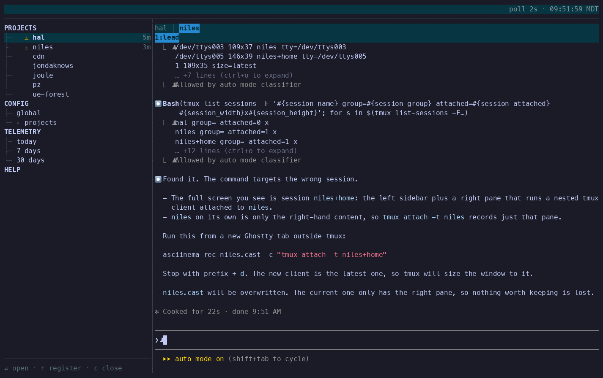

[](https://github.com/Rhovian/niles/actions/workflows/ci.yml?query=branch%3Amain)
[](https://crates.io/crates/niles)

Niles orchestrates multi-agent and multi-family workflows across projects from one terminal
window. It runs Claude Code, Codex, and pi side by side in tmux; the skills you choose decide how
they work together. See the [roadmap](ROADMAP.md) and [releases](https://github.com/Rhovian/niles/releases).



## Is it for you

It suits you if you want to use several model families rather than commit to one. Small work can
stay with one agent; complex work can get a second family's scrutiny. Most of the extra cost is
in starting and stopping agents, so you choose when it's worth it.

It isn't for you if you don't want to be in the terminal at all; the [remote PWA](#remote-access-opt-in)
keeps that time small.

> **Trust:** Niles's default worker launch flags bypass agent approval prompts, and Niles provides no
> sandbox. Read the [threat model](docs/security.md) before running agents on a repository.

## Requirements

Unix, `tmux`, and at least one agent CLI installed, on `PATH`, and logged in. Rust 1.89+ only if
you install with Cargo. Latest tested CLI versions (older ones aren't blocked; report breakage
with the version):

| CLI | Tested version |
| --- | --- |
| Claude Code | 2.1.312 |
| Codex | 0.165.0 |
| pi coding agent | 1.4.0 |

## Quickstart

For agent-led installation (requires Node.js 22.20+), run this in your repository to add the
[niles skill](skills/niles/SKILL.md) to your coding agent:

```sh
npx skills add Rhovian/niles --skill niles
```

Then ask your agent to install Niles for this repository. It previews the changes, installs
prerequisites, and uses `niles setup` to configure and launch an entry agent without the wizard.

1. Install Niles with one of:

   ```sh
   brew tap Rhovian/niles && brew install niles
   curl --proto '=https' --tlsv1.2 -LsSf https://github.com/Rhovian/niles/releases/latest/download/niles-installer.sh | sh
   cargo install niles
   ```

   Run `niles update` to update a shell installation. Homebrew and Cargo installations show
   their package-manager command. Older shell installations need the installer run once more
   to get the updater.

   Use `niles update --channel nightly` to include nightly prereleases from main;
   the default `--channel stable` only considers stable releases. The updater only
   installs newer versions, so returning to stable may require waiting for the next
   stable release or rerunning the stable shell installer. Channel selection applies
   to this invocation; nightly requires a shell installation. Nightly binaries and
   installer receipts both use the versioned nightly tag (without its `v` prefix).

2. Run Niles in your repository and answer the setup prompts:

   ```sh
   cd <repo> && niles
   ```

   Confirm the folder and name, then follow the picker: lead or solo, a lead entry skill
   (`lead` or a custom skill import reference), model tiers and entry agent preselected from
   detected CLIs, and optional starter skills (none checked). Edit primaries and ordered secondaries
   in the tier form. Use ←/Esc back and `q` quit; in text input, use Esc back and F10 quit.
   Review the safety warning above the summary on one final screen; Enter accepts the warning,
   writes the manifest and starts the entry agent.
   Registration is optional; `r` in the home view registers later projects.

Detach with `Ctrl-b d`; agents keep running. See the [interface reference](docs/setup.md) for keys and
the status bar.

## How it works

Each project is a tmux session. You, the operator, talk to the entry agent, whose skill sets what
it does: a lead spawns workers in their own windows and reads their reports; solo does the work
itself. The manifest defines project-wide model tiers (`family:model:effort`) usable by every skill;
`niles models` lists the approved agents.

## Skills in this repository

The binary embeds no skill text. Setup fetches the entry skill and selected starter skills from
this repository’s latest Git HEAD into `~/.niles/skills`, recording the resolved commit SHA.
Existing skills are kept; copy or pin others with
`niles skills import Rhovian/niles/skills/<name>@<rev>`.

- `lead` coordinates: talks to you, spawns agents, forwards their work.
- `solo` does your request directly in one session.
- `worker` implements a change and runs focused checks.
- `reviewer` reviews correctness, idiom, economy, and tests.
- `security` asks what an attacker can do with a change.
- `design` writes a design record before implementation.
- `research` answers one question with sources and edits nothing.

Installing a skill plugin doesn't install the Niles binary or configure a workspace. Skills that
operate Niles, such as `lead` and `cost-analysis`, still need its CLI and configured state;
use the [quickstart](#quickstart) to set those up. Niles continues to import the same skill
files through `niles skills import`.

### Install in Codex

Install all skills directly in Codex, independently of a Niles-launched session:

```sh
codex plugin marketplace add Rhovian/niles
codex plugin add niles@niles
```

Start a new Codex session and select a skill with `/skills`. The plugin exposes the whole
[`skills/`](skills/) directory, including skills added in future marketplace updates.
To refresh the marketplace, run `codex plugin marketplace upgrade niles`, then
`codex plugin add niles@niles` to refresh the installed plugin.

These commands use Codex's [repo marketplace support](https://developers.openai.com/plugins/build/plugins).

### Install in Claude Code

In Claude Code, add the marketplace and install the bundle:

```text
/plugin marketplace add Rhovian/niles
/plugin install niles@niles
```

Invoke a skill by its plugin-qualified name, such as `/niles:reviewer` or `/niles:claude-trim`.
The plugin packages only [`skills/`](skills/) and includes every skill in that directory.
See Claude Code's [marketplace documentation](https://code.claude.com/docs/en/plugin-marketplaces).

## What Niles changes on your machine

Niles writes under `~/.niles/` (state, project list, skill cache, config, worktrees, remote keys),
fetches selected skills from GitHub’s latest Git HEAD on first setup and records their commit SHAs,
creates one tmux session per project, and creates branches for worktree spawns. It doesn't touch your agent CLIs' or tmux's
config. To remove it, close its projects in the home view (`c`), uninstall the binary, and delete `~/.niles` and
any `.niles/` in your repositories. See
[state layout](docs/configuration.md#state-layout) for details.

## Configuration

Each project's manifest lives at `~/.niles/state/<workspace key>/@state/manifest.yaml`
(see [state layout](docs/configuration.md#state-layout) for the encoding). First-run setup
generates it from your installed agent CLIs. It names the entry skill and the agent it runs on, and defines project-wide tiers with a `primary`
and ordered fallback `secondaries`:

```yaml
entry: lead
entry_agent: codex:gpt-6.1-sol:medium
tiers:
  standard: {primary: codex:gpt-6.1-sol:medium, secondaries: [claude:opus:medium, pi:deepseek/deepseek-v4.1-flash:high, pi:z-ai/glm-5.3-flash:high, claude:sonnet:high]}
  frontier: {primary: claude:fable:high, secondaries: [codex:gpt-6-astra:high, claude:fable:medium, codex:gpt-6-astra:medium, claude:opus:high]}
  economy: {primary: claude:sonnet:medium, secondaries: [codex:gpt-6-luna:high, codex:gpt-5.6-terra:xhigh, codex:gpt-6.1-sol:low, claude:opus:low]}
  mechanical: {primary: claude:sonnet:low, secondaries: [pi:z-ai/glm-5.3-flash:low, codex:gpt-6-luna:medium, codex:gpt-5.6-terra:high, pi:deepseek/deepseek-v4.1-flash:low, codex:gpt-6-luna:low, claude:haiku]}
```

The manifest's worktree `setup` runs with your permissions, so keep it trusted. See
[configuration](docs/configuration.md) and [skill workflows](docs/skills.md) for the rest.

## Remote access (opt-in)

The installable [PWA](apps/pwa/README.md) lists sessions, chats with the foreground agent, and sends
Web Push when attention is needed. Phone access is shell access on the host. Prebuilt binaries
omit the `remote` feature; follow the [remote setup guide](docs/remote.md) and read the
[threat model](docs/security.md#remote-api).

## Contributing and security

See [CONTRIBUTING.md](CONTRIBUTING.md) to contribute. Report suspected vulnerabilities privately
according to the [security policy](SECURITY.md).

## License

Licensed under [MIT](LICENSE-MIT).

By intentionally submitting a contribution for inclusion in this project, you agree to license
your contribution under MIT.
