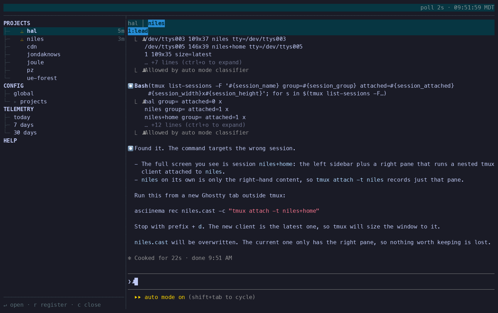

[](https://github.com/Rhovian/niles/actions/workflows/ci.yml?query=branch%3Amain)
[](https://crates.io/crates/niles)

Niles orchestrates multi-agent and multi-family workflows across projects from one terminal
window. It runs Claude Code, Codex, and pi side by side in tmux; the skills you choose decide how
they work together. See the [roadmap](ROADMAP.md) and [releases](https://github.com/Rhovian/niles/releases).



## Is it for you

It suits you if you want to use several model families rather than commit to one. Small work can
stay with one agent; complex work can get a second family's scrutiny. Most of the extra cost is
in starting and stopping agents, so you choose when it's worth it.

It isn't for you if you don't want to be in the terminal at all; the [remote PWA](#remote-access-opt-in)
keeps that time small.

> **Trust:** Niles's default worker launch flags bypass agent approval prompts, and Niles provides no
> sandbox. Read the [threat model](docs/security.md) before running agents on a repository.

## Requirements

Unix, `tmux`, and at least one agent CLI installed, on `PATH`, and logged in. Rust 1.89+ only if
you install with Cargo. Latest tested CLI versions (older ones aren't blocked; report breakage
with the version):

| CLI | Tested version |
| --- | --- |
| Claude Code | 2.1.312 |
| Codex | 0.165.0 |
| pi coding agent | 1.4.0 |

## Quickstart

1. Install Niles with one of:

   ```sh
   brew tap Rhovian/niles && brew install niles
   curl --proto '=https' --tlsv1.2 -LsSf https://github.com/Rhovian/niles/releases/latest/download/niles-installer.sh | sh
   cargo install niles
   ```

2. Install the setup skill: the first line for Claude Code, the second for Codex and pi.

   ```sh
   mkdir -p ~/.claude/skills/niles-setup && curl -fsSL https://raw.githubusercontent.com/Rhovian/niles/main/skills/niles-setup/SKILL.md -o ~/.claude/skills/niles-setup/SKILL.md
   mkdir -p ~/.agents/skills/niles-setup && curl -fsSL https://raw.githubusercontent.com/Rhovian/niles/main/skills/niles-setup/SKILL.md -o ~/.agents/skills/niles-setup/SKILL.md
   ```

3. In your repository, ask that agent to "set up Niles here". It copies skills, writes the
   manifest with you, and checks the result with `niles doctor`.

4. Run `niles` in the repository, select the project and press Enter (press `r` to register it if
   it isn't listed). Press `c` in the skills picker to keep the manifest, then type to your entry
   agent in the right pane.

Detach with `Ctrl-b d`; agents keep running. See the [interface reference](docs/setup.md) for keys and
the status bar.

## How it works

Each project is a tmux session. You, the operator, talk to the entry agent, whose skill sets what
it does: a lead spawns workers in their own windows and reads their reports; solo does the work
itself. The manifest binds each skill to an agent (`family:model:effort`) with optional cheaper or
stronger tiers; `niles models` lists them.

## Skills in this repository

The binary contains no skills. Copy the [skills](skills/) you want into `.niles/skills/` or
`~/.niles/skills/`, or pin them with `niles skills import Rhovian/niles/skills/<name>@<rev>`.

- `lead` coordinates: talks to you, spawns agents, forwards their work.
- `solo` does your request directly in one session.
- `worker` implements a change and runs focused checks.
- `reviewer` reviews correctness, idiom, economy, and tests.
- `security` asks what an attacker can do with a change.
- `design` writes a design record before implementation.
- `research` answers one question with sources and edits nothing.
- `niles-setup` installs Niles and writes the manifest with you.

## What Niles changes on your machine

Niles writes under `~/.niles/` (state, project list, skill cache, config, worktrees, remote keys),
creates one tmux session per project, and creates branches for worktree spawns. It doesn't touch your agent CLIs' or tmux's
config. To remove it, close its projects in the home view (`c`), uninstall the binary, and delete `~/.niles`, the
`niles-setup` skill directories, and any `.niles/` in your repositories. See
[state layout](docs/configuration.md#state-layout) for details.

## Configuration

Each project's manifest lives at `~/.niles/state/v2/<workspace key>/@state/manifest.yaml`
(see [state layout](docs/configuration.md#state-layout) for the encoding). The setup skill
writes it; Niles has no default. It names the entry skill and binds each skill to a `standard`
tier `primary`, with optional fallback `secondaries`:

```yaml
entry: lead
lead: {standard: {primary: claude:opus:medium, secondaries: []}}
worker: {standard: {primary: codex:gpt-6.1-sol:medium, secondaries: []}}
reviewer: {standard: {primary: claude:sonnet:high, secondaries: []}}
```

The manifest's worktree `setup` runs with your permissions, so keep it trusted. See
[configuration](docs/configuration.md) and [skill workflows](docs/skills.md) for the rest.

## Remote access (opt-in)

The installable [PWA](web/README.md) lists sessions, chats with the foreground agent, and sends
Web Push when attention is needed. Phone access is shell access on the host. Prebuilt binaries
omit the `remote` feature; follow the [remote setup guide](docs/remote.md) and read the
[threat model](docs/security.md#remote-api).

## Contributing and security

See [CONTRIBUTING.md](CONTRIBUTING.md) to contribute. Report suspected vulnerabilities privately
according to the [security policy](SECURITY.md).

## License

Dual-licensed under [MIT](LICENSE-MIT) or [Apache-2.0](LICENSE-APACHE), at your option.

Unless you explicitly state otherwise, any contribution intentionally submitted for inclusion in
this project by you, as defined in the Apache-2.0 license, shall be dual licensed as above, without
any additional terms or conditions.
